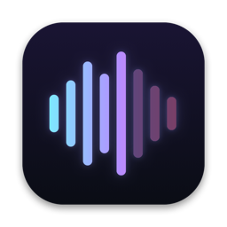
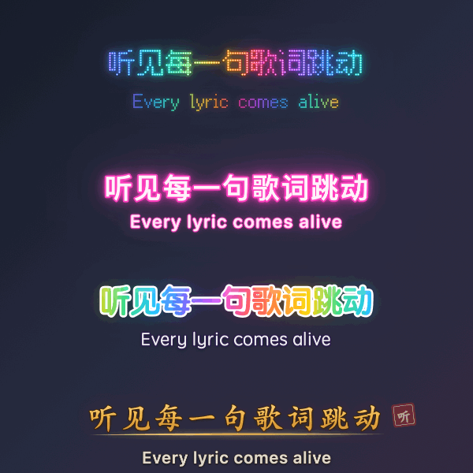
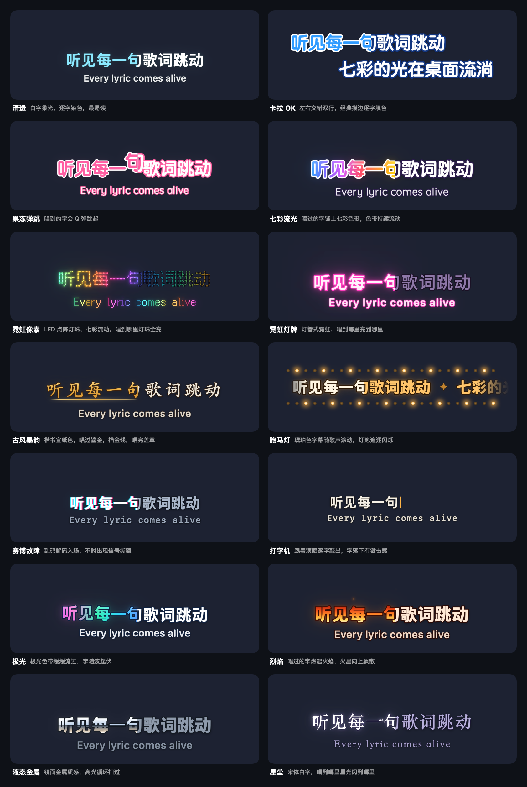
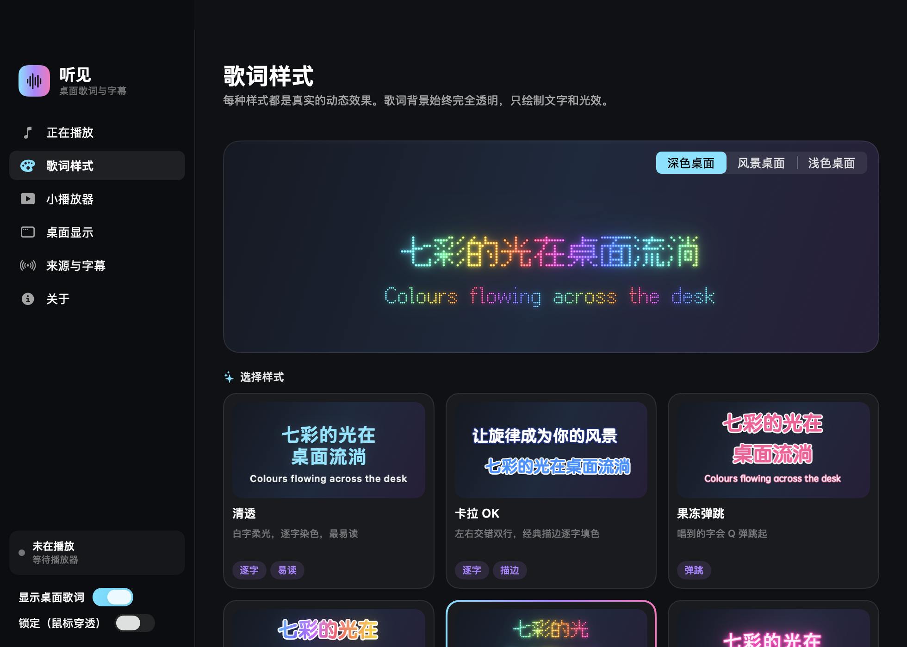
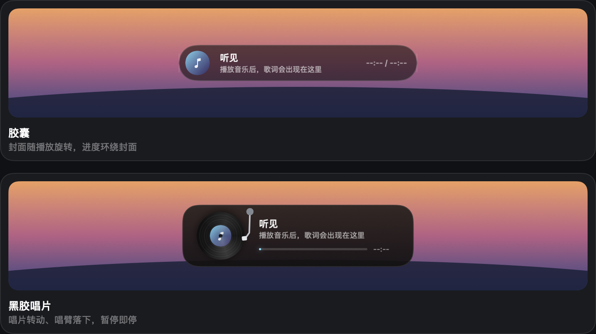

<div align="center">



# 听见

**Mac 桌面歌词：跟随网易云音乐，逐字卡拉 OK，14 种真实动态特效**

Animated, karaoke-style desktop lyrics for macOS. Follows NetEase Cloud Music; other players via song recognition.

macOS 26+ · Apple 芯片 · Swift / SwiftUI · 只需 Command Line Tools 即可构建



</div>

## 功能

- **跟随网易云音乐**：只读网易云在本机的播放状态，不需要录屏权限。窗口隐藏、最小化、后台切歌、暂停、拖动进度都能跟上。
- **其他播放器（QQ 音乐等）**：打开「听歌识曲」，识别 Mac 正在播放的歌，切歌后约 6–12 秒跟上。
- **优先保证有歌词**：同时查网易云、QQ 音乐、酷狗、LRCLIB。精确匹配失败就逐级降级，只排除明显不相符的结果。现场版找不到现场歌词时，改用录音室歌词并标明。
- **逐字卡拉 OK**：有逐字时间的歌词（如酷狗 KRC）逐字染色，其余按行推进。有翻译时显示在第二行。
- **14 种动态样式**，每种都能细调（见下文）。
- **不挡桌面**：歌词背景完全透明，只有文字区域接收鼠标。
  - 拖动可以移动歌词，双击打开主窗口。
  - 鼠标停在歌词上会出现工具条，右键有快捷菜单。
  - 锁定后鼠标完全穿透。
- **小播放器**：胶囊、黑胶唱片、玻璃卡片、专辑氛围、极简细线五种。鼠标移上去可以微调歌词时间。
- **实时字幕**：把 Mac 正在播放的声音在本机转成字幕。
- **按歌曲记住**：所选歌词版本和时间偏移按歌曲记住，歌词缓存在本机。

## 样式



| 样式 | 效果 |
|---|---|
| 清透 | 白字柔光，逐字染色，最易读 |
| 卡拉 OK | 左右交错双行，经典描边逐字填色 |
| 果冻弹跳 | 唱到的字会 Q 弹跳起 |
| 七彩流光 | 唱过的字铺上七彩色带，色带持续流动 |
| 霓虹像素 | LED 点阵：像素字体的每个像素是一颗灯珠，七彩流动；唱到的灯珠全亮、灯芯发白 |
| 霓虹灯牌 | 白色灯芯 + 粉色灯管 + 光晕，唱到哪里亮到哪里；换句时旧灯牌熄灭、新一句逐字点亮 |
| 古风墨韵 | 楷书宣纸色，唱过鎏金，描金下划线，唱完盖章 |
| 跑马灯 | 琥珀色字幕随歌声滚动，上下两排灯泡追逐闪烁 |
| 赛博故障 | 唱过的字带青 / 品红色差，乱码解码入场，不时信号撕裂 |
| 打字机 | 跟着演唱逐字敲出，字落下有键击感 |
| 极光 | 极光色带缓缓流过，字随波起伏 |
| 烈焰 | 唱过的字燃起火焰，火星向上飘散 |
| 液态金属 | 镜面金属质感，高光循环扫过 |
| 星尘 | 宋体白字，唱到哪里星光闪到哪里 |

所有样式的文字都不透明，并用描边、灯板或字底衬托，在深色、彩色、浅色桌面上都看得清。

可以细调的项目：

- **字体**：苹方、圆润、圆体、宋体、楷体、行楷、魏碑、隶书、手写、像素、等宽。
- **颜色与填充**：纯色、渐变、流动色带、逐字彩色、火焰、金属。
- **光效**：发光、字底光晕、描边、阴影、霓虹闪烁、信号撕裂、像素灯珠。
- **动态**：持续动效、换句动画、粒子、装饰、动画速度。
- **排版**：居中双行、KTV 交错、跑马灯滚动。
- **其他**：字号、不透明度。

## 界面

主窗口的「歌词样式」页：上方实时预览，可切换深色、风景、浅色三种桌面背景；下方是样式库。



歌词下方的小播放器（图为胶囊和黑胶唱片两种）：



## 安装

1. 在 [Releases](../../releases) 下载最新版，解压后把「听见」拖进「应用程序」。也可以从源码构建，见下文。
2. 应用没有经过 Apple 公证，第一次打开会被系统拦下。到「系统设置 → 隐私与安全性」，在页面下方点「仍要打开」。
3. 打开后菜单栏出现波形图标，桌面歌词显示在屏幕上方。

## 使用

- **网易云音乐**：直接播放，歌词自动出现。App Store 版网易云第一次可能弹出「访问其他 App 的数据」，允许即可。
- **QQ 音乐等其他播放器**：在「来源与字幕」打开「听歌识曲」，按提示允许「屏幕与系统录音」。macOS 把读取系统声音也归在这项权限里；听见只读声音，不读取屏幕画面。
- **歌词快了或慢了**：
  - 鼠标移到小播放器上，点 − / + 按 0.5 秒调整，也可以在右键菜单「歌词时间」里调。
  - 在「正在播放」页点一下正在唱的那一句，立即校准。
  - 歌词版本不对时，在同一页点「换一个版本」。
- **换样式**：鼠标停在歌词上，点工具条的调色板按钮轮换样式。也可以在「歌词样式」页切换深色、风景、浅色三种背景预览，再细调。
- **锁定**：点工具条上的锁，鼠标就完全穿透歌词和小播放器。要解锁，把鼠标在歌词上停一会儿，会出现解锁按钮。
- **帧率**：在「桌面显示 → 动画流畅度」选 20 / 30 / 60 帧。

## 歌词匹配：逐级降级

- **精确匹配**（正常同步）：播放器给出的网易云歌曲 ID；或歌名、歌手、版本都相同，且时长差 ≤ 2 秒。
- **匹配**（正常同步）：去掉版本标注后歌名相同、歌手重合、版本相同，且时长差 ≤ 5 秒。
- **相近版本**（同步，并提示可用 ± 微调）：版本不同（如现场版用录音室歌词）、时长差 5–25 秒，或中英文歌手名不同但时长一致。
- **同名歌曲**（同步，并提示可能是其他版本）：歌名相同但歌手不重合，时长接近。
- **排除**（不显示）：歌名明显不同、时长相差过大、伴奏或纯音乐版、空歌词。

有同步歌词时优先用同步歌词。只有纯文本歌词时，按歌曲时长估算滚动，并标明是估算。

## 隐私

- **查歌词**：只发送歌名、歌手、专辑、时长（网易云另加播放器提供的歌曲 ID），不登录，不读取 Cookie。
- **网易云播放状态**：只在本机只读。不修改网易云的数据，不导出播放列表。
- **听歌识曲**：只发送本机生成的声音指纹，不上传、不保存录音。
  - 第一次使用时，会从 Chrome 应用商店的更新服务器下载网易云音乐官方扩展，校验 SHA-256 后保存在 `~/Library/Application Support/ListenOverlay/Runtime/`，用来在本机生成指纹。
  - 这些文件不包含在本仓库和应用里。
- **本机缓存**：歌词、版本选择和时间偏移都保存在 `~/Library/Application Support/ListenOverlay/`。

## 从源码构建

需要 macOS 26 及以上、Apple 芯片、Command Line Tools（`xcode-select --install`），不需要 Xcode。

```sh
./test.sh            # 离线测试：不联网，不需要任何权限
./build.sh --adhoc   # 构建 dist/听见.app（临时签名）
```

每次构建都换一个临时签名，系统授予的「屏幕与系统录音」权限就会失效。想让权限在重新构建后保留，就改用固定的本机签名。初始化只需一次，会在 `~/Library/Application Support/ListenOverlay/Signing` 生成一个专用钥匙串，不改动系统钥匙串和信任设置：

```sh
python3 Scripts/sign_app.py --init   # 只需一次
./build.sh
```

<details>
<summary>调试参数与开发工具</summary>

启动参数：

- `--simulate "歌名|歌手|专辑|时长|位置"`：模拟播放器读数，走真实的歌词查找。
- `--demo`：循环播放示例歌词。
- `--style <样式>`、`--player <小播放器>`、`--fps 20|30|60`：注意这三个会写进保存的设置。
- `--capture-ui <目录>`：把各页面、桌面歌词和小播放器的悬停状态渲染成 PNG，不需要录屏权限。液态玻璃效果不会出现在这些截图里。
- `--regular`：显示程序坞图标。
- `--background`：启动时不打开主窗口。

`Tools/Snapshot` 里的工具，构建命令写在各自文件开头：

- `StyleReview.swift`：把每种样式放在深色、彩色、浅色三张系统壁纸上按实际大小渲染，另出换句动画胶片和全部样式对照图。
- `ReadmeImages.swift`：生成本页的样式总览图和动图。
- `StyleSnapshot.swift`：单张样式总览。

macOS 27 SDK 把 SwiftUI 的 `@State` 改成了需要 Xcode 插件展开的宏。本项目改用 `ViewState`（`@StateObject`），所以只用 Command Line Tools 也能构建。

</details>

## 项目结构

- **`Sources/App`**
  - `AppModel`：跟随播放器、查歌词、字幕状态。
  - `AppSettings`、`LyricsBridge`。
  - `main`：菜单栏、窗口、调试参数。
- **`Sources/Overlay`**：桌面歌词。
  - `GlyphLayout`：Core Text 排版一次，字形图缓存。
  - `GlyphPainter`：全部文字特效，含 LED 点阵、粒子、装饰。
  - `LyricStageView`：单个 Canvas 绘制的舞台，包括居中双行、KTV 交错、跑马灯和灯泡。
  - `LyricTimeline`：歌词时间轴。
  - `LyricStyle`：样式与预设。
  - `OverlayController`、`OverlayPanel`：透明面板、悬停、拖动、双击、工具条、右键菜单。
  - `MiniPlayerView`：小播放器。
- **`Sources/UI`**：主窗口各页面。
- **`Sources/Lyrics`**：四个歌词来源、匹配分级、LRC / KRC 解析、缓存。
- **`Sources/Players`**：网易云本机播放状态、`PlayerTracker`。
- **`Sources/Recognition`、`Sources/Audio`**：听歌识曲（网易云 + Shazam 核对）、系统声音采集、本机语音转写。
- **`Tests`**：`./test.sh` 运行的离线测试。

## 已知限制

- QQ 音乐只能靠听歌识曲跟随，切歌后约 6–12 秒才跟上。从 macOS 15.4 起，普通应用读不到系统的「正在播放」信息。
- 网易云跟随依赖网易云在本机的播放记录格式，网易云大版本更新后可能需要适配。
- 只支持 Apple 芯片、macOS 26 及以上，没有 Windows 版。
- 应用没有 Developer ID 签名，也没有经过公证。
- 楷体、行楷、魏碑、隶书、圆体、宋体、手写都是 macOS 按需下载的系统字体。第一次选用时自动下载，下载完成前先用系统字体显示。
- 动画时的 CPU 占用随帧率和样式变化，本机 20 帧时约 4–7%。暂停或没有播放时约 0.3–1%。

## 致谢

- [Fusion Pixel Font](https://github.com/TakWolf/fusion-pixel-font)（SIL OFL 1.1）：霓虹像素样式用的像素字体。随应用附带，只在本进程内注册，不安装到系统。
- [Audicap](https://github.com/ShinoKana/audicap)（MIT）：系统声音采集与转写仲裁的参考。
- [ShazamIO](https://github.com/shazamio/ShazamIO)（MIT）：Shazam 识曲接口格式的参考。
- [CloudLyrics for macOS](https://github.com/hellomyonly55/CloudLyrics-for-macOS)（MIT）：网易云本机播放记录格式的参考。
- [NeteaseCloudMusicApiEnhanced](https://github.com/NeteaseCloudMusicApiEnhanced/api-enhanced)（MIT）：歌词与识曲接口的社区文档。
- [LRCLIB](https://lrclib.net)：开放的同步歌词库。

各组件的完整说明与许可见 [THIRD_PARTY_NOTICES.md](THIRD_PARTY_NOTICES.md)。

## 免责声明

- 本项目与网易云音乐、QQ 音乐、酷狗音乐、LRCLIB、Shazam、Apple 均无关联。
- 歌词与识曲用的是公开但非官方的接口，随时可能变化或失效。
- 歌词内容的版权归原权利人所有。本项目仅供个人学习与使用。

## 许可证

代码许可证尚未确定。第三方组件按各自的许可证使用，见 [THIRD_PARTY_NOTICES.md](THIRD_PARTY_NOTICES.md)。
